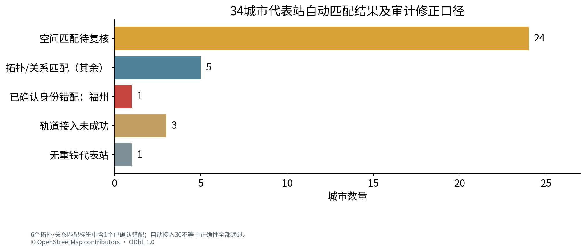
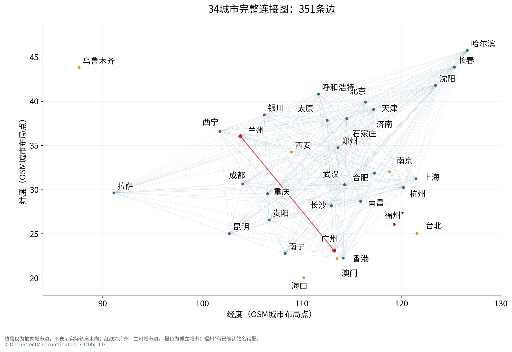
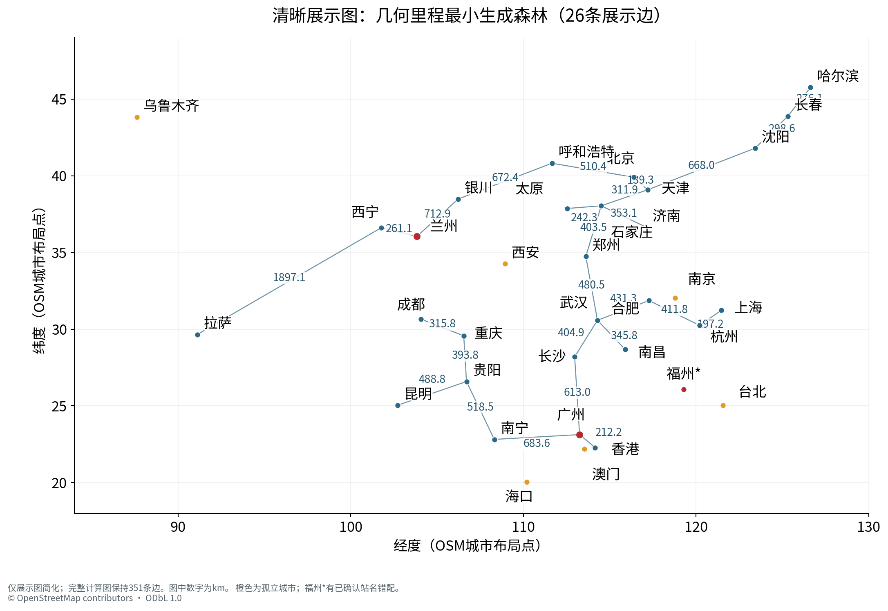
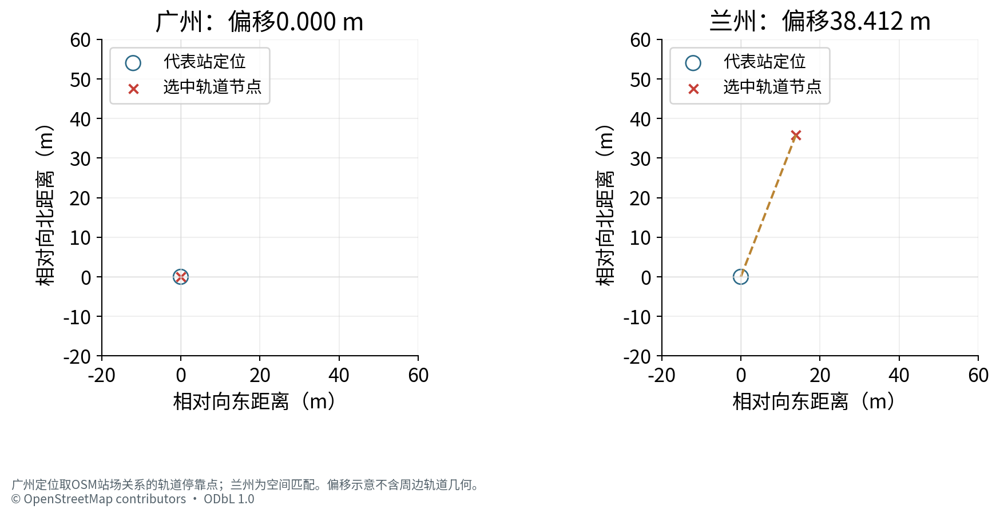
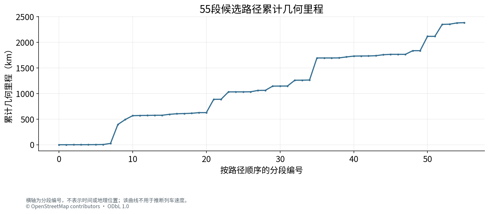
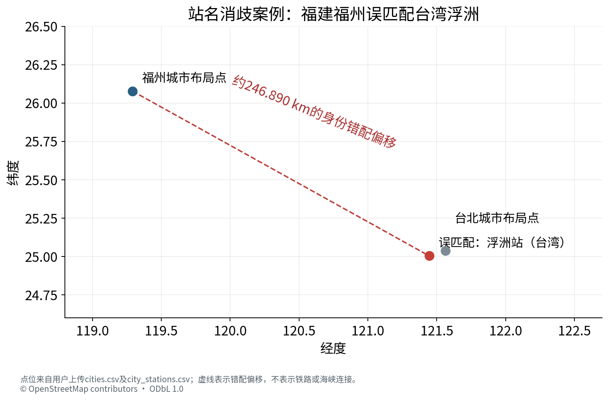

# 基于OpenStreetMap的省级行政区代表城市铁路网络构建及最短几何路径分析

《人工智能》课程大作业 · 第一阶段真实数据实验与质量核验

## 摘　要

本实验以34个省级行政区代表城市为节点，使用Geofabrik提供的中国与台湾OpenStreetMap数据，构建共享OSM节点连接的无向铁路基础设施图。轨道边权按WGS84椭球上折线全部相邻坐标点的测地距离累计，采用Dijkstra算法计算广州站至兰州站的候选最短几何路径，并将代表站间不经过第三个选定代表站节点的最短通路压缩为城市边。

用户本地全国数据运行记录显示：底层图含294,713个搜索节点、296,408条边和1,671个连通分量；34城市图含351条边、8个连通分量。程序自动接入30个代表站，广州至兰州候选最短几何里程为2383.541508 km。对上传CSV独立复算得到相同的城市图距离；55段长度之和与总值仅差约9.1×10^(-13) km，相邻分段节点连续。

质量审计同时发现福州被错配到台湾浮洲站，已将该身份匹配标为拒绝；排除后保留29个候选接入，其中24个空间匹配仍待复核，包括兰州站。因此，“自动接入30个”不能等同于“30个代表站正确性已验证”。本文保留原始运行结果与审计状态，将2383.542 km限定为当前筛选规则和站点锚点下的图上候选最短几何里程，不将其表述为官方客运里程或可乘坐列车方案。

关键词：OpenStreetMap；铁路拓扑；Dijkstra；几何里程；代表站映射；数据质量

## 阅读说明

本报告基于用户上传的8份实际结果文件，不使用人工测试样例作为实验数据。正文区分“程序记录的自检”“本次对导出表的独立核验”与“尚需原始轨道几何或人工检查的事项”。报告没有重新解析全国PBF，也没有补造未上传的实际线路走向图。姓名、学号、专业班级和任课教师均留空待填写。

## 1　作业题目与数据建模

### 1.1　任务定义与城市口径

题目要求构建34个省级行政区代表城市的铁路网络，以广州到兰州为单方向路径寻优对象。本项目将“34个省会城市及直辖市”统一解释为各省会、自治区首府、直辖市及特别行政区代表城市。节点按用户规定顺序保留，无法定位、没有符合口径的铁路或与其他代表站不连通时，仍保留为孤立节点。

城市顺序为：北京、天津、上海、重庆、石家庄、太原、呼和浩特、沈阳、长春、哈尔滨、南京、杭州、合肥、福州、南昌、济南、郑州、武汉、长沙、广州、南宁、海口、成都、贵阳、昆明、拉萨、西安、兰州、西宁、银川、乌鲁木齐、台北、香港、澳门。研究不生成34×34距离矩阵，不开展A*或MATLAB对比，也不以未运行实验补足结果。

### 1.2　真实数据来源与时间

原始数据由用户在Windows电脑本地提供。中国与台湾文件的PBF复制时间戳均为2026-10-13T20:21:31Z，即北京时间2026年10月14日04:21:31；本次处理完成时间为北京时间2026年10月15日08:52:52。数据复制时间、下载/登记时间和程序完成时间含义不同。

| 文件 | 字节数 | PBF复制时间（UTC） | 完整解析记录 |
| --- | --- | --- | --- |
| china-latest.osm.pbf | 1608188315 | 2026-10-13 20:21:31 | 通过 |
| taiwan-latest.osm.pbf | 327561702 | 2026-10-13 20:21:31 | 通过 |

来源为https://download.geofabrik.de/asia/china-latest.osm.pbf与https://download.geofabrik.de/asia/taiwan-latest.osm.pbf。两文件SHA-256与读取记录见附录。来源清单标记为用户本地文件，未联网核对上游MD5；不能将PBF可解析与本地SHA记录写成已经完成上游发布者校验。OSM数据署名为© OpenStreetMap contributors，许可为ODbL 1.0。

### 1.3　底层铁路图与距离定义

采用pyosmium两遍流式扫描，先保留相关铁路way、车站/站场关系及所需节点ID，再扫描坐标和布局节点。两个文件累计扫描268,360,850条原始node记录；这不是去重后的铁路节点数。程序需要的铁路/站点坐标引用为2,335,173个，压缩形状点后的搜索图才是294,713个节点。最终34个城市节点又属于另一层抽象，三者不能混用。

仅选择正常标签为railway=rail的轨道；地铁、轻轨、有轨电车、废弃/在建及显式工业、军用、纯货运和受限访问线路按代码规则排除。service=yard/siding/spur/crossover不作为任意主干捷径，只保留代表站接入主线所需的最短辅助支路。未知用途不补写为客运，usage=spillway、usage=yard等异常标签也必须在后续清洗中复核。

轨道仅在共享OSM节点ID上连接。几何交叉、双线临近、车站名称相同都不自动构成轨道连接。平行线路保存各自拓扑，搜索选取某条可行边，不把双线长度累计为一次行程。铁路渡轮和其他非轨道连接不加入图。分析使用无向图，忽略运行方向、时刻表与车辆运营兼容性。

若轨道折线为P=(p_0,p_1,…,p_m)，其长度定义为 L(P)=Σ d_WGS84(p_i,p_(i+1))/1000，单位km。程序使用pyproj.Geod(ellps="WGS84")求相邻坐标点的椭球测地线距离。所有形状点参与累计，不能对经纬度直接求平面length，也不能只计算两端直线距离。

### 1.4　代表车站映射与压缩边

每个城市固定选择一个主要重铁站：如广州站、兰州站、重庆北站、成都东站、台北车站、香港西九龙站。城市中心只用于图形布局，不参与铁路长度计算。映射按站点在轨道上、OSM站场停靠关系、150 m以内最近实际轨道节点的顺序进行。空间匹配仅确定锚点，不创建站房到线路的铁路边，其偏移不计入铁路里程。

城市边表示两代表站之间存在不经过第三个选定代表站轨道节点的通路，并在此约束下取最短几何长度。允许其他车站及非省会城市。搜索到另一代表站时记录结果且不穿过该节点；普通轨道节点继续扩展。这一定义不等于直达列车，也不等于城市行政区之间没有中途经过。

## 2　Dijkstra算法与程序设计

### 2.1　最短路径原理

设无向加权图为G=(V,E,w)，几何权重非负。令起点距离dist[s]=0，其余为无穷大，利用优先队列反复取出当前距离最小的候选节点u。对每条邻边(u,v)执行松弛：若dist[u]+w(u,v)<dist[v]，则更新距离及前驱。候选最小节点的距离不能被之后的非负绕行改善，因此逐步得到最短距离。

二叉堆实现的通常复杂度为O((|V|+|E|)log|V|)，图与前驱存储为O(|V|+|E|)。底层图使用CSR稀疏存储；同一端点对存在平行边时，稀疏搜索权重取最短真实边，同时保留对应OSM轨道标识以恢复路径。

### 2.2　伪代码与分层调用

```text
dist[s] = 0; dist[other] = infinity
Q = priority_queue((0, s)); predecessor = {}
while Q is not empty:
    (d, u) = extract_min(Q)
    if d != dist[u]: continue
    if city_compression and u is another selected anchor:
        record_edge_and_path(s, u); continue
    for (v, weight) in neighbors(u):
        if d + weight < dist[v]:
            dist[v] = d + weight
            predecessor[v] = u
            push(Q, (dist[v], v))
restore track path using predecessor
```

城市压缩搜索由heapq实现，另一个代表站作为停止扩展的屏障；广州至兰州的底层查询使用SciPy的Dijkstra库函数。报告另附独立Python Dijkstra校验脚本，复算上传city_edges.csv中的单方向距离。这是同一算法的独立实现核验，不将其夸大为Dijkstra与A*的多算法实验。

### 2.3　实现模块与复现

| 模块 | 职责 |
| --- | --- |
| extract.py | PBF流式提取、对象类型/ID去重及版本记录 |
| stations.py | 城市布局、代表站识别与轨道锚点匹配 |
| graph.py | 折线WGS84长度、轨道图与受约束城市压缩 |
| export.py | 连续性/长度自检、GeoJSON与CSV导出 |
| plotting.py | 完整城市图、展示图和车站/路线检查图 |
| report/verify_results.py | 独立校验上传表格及广州→兰州城市图距离 |

本地环境为Python 3.12 64位及项目虚拟环境；源码固定依赖包括osmium 4.3.1、pyproj 3.8.0、SciPy 1.17.0、NumPy 2.3.5和Matplotlib 3.10.8。安装依赖需要网络，已有有效PBF的正式处理和绘图默认离线进行。数据、子集SQLite和图缓存分别保存，缓存由输入哈希及策略版本识别。

## 3　实验结果及讨论

### 3.1　规模、覆盖与代表站结果

| 指标 | 用户运行记录/本次核验结果 |
| --- | --- |
| 城市节点 | 34，名称和顺序独立核验一致 |
| 底层搜索图 | 294,713节点；296,408边；1,671连通分量 |
| 城市图 | 351条唯一正权边；8个连通分量 |
| 自动接入代表站 | 30/34（88.24%）；不是正确率 |
| 拓扑/关系匹配标签 | 6个，其中福州被确认身份错配 |
| 空间匹配待复核 | 24个，包含兰州站 |
| 无可靠轨道锚点 | 海口、西安、乌鲁木齐 |
| 无重铁代表站 | 澳门 |
| 缺失形状点的way | 程序记录0；零长度折线段2条被排除 |

相关铁路子集中没有记录到跨文件重复对象和版本/内容冲突；该计数不代表对全国所有原始OSM对象进行全量重复审计。中国文件实际node包围框与台湾文件包围框均超出各自头部范围；包围框覆盖与重叠只能作范围提示，不能证明每个区域铁路完整，也不能凭包围框相交断定轨道重复。



本次共有7个孤立城市：南京、福州、海口、西安、乌鲁木齐、台北、澳门。海口、西安、乌鲁木齐属于所选站没有可靠轨道锚点；南京已经映射但处于不同底层分量；台北位于独立铁路分量；福州的原始孤立状态还受到错误身份映射影响。不能把这些状态统一解释为现实中没有铁路。

### 3.2　城市图密度与展示规则

独立根据CSV重新构图，得到27个城市组成的主体分量和7个孤立节点，合计8个分量。主体中每个城市的度均为26，且351=27×26/2，故该主体是完全图K27；全图边密度为351/(34×33/2)=62.57%。

密图与站点屏障的定义有关：被禁止穿过的是单个选定轨道节点，而不是整个站场或城市区域。线路能够绕过该节点时，仍可能连接任意两端。这不是凭视觉任意补边，也不能仅凭完全图就认定程序直接输出了全城市两两距离；但其邻接含义较宽，必须在报告中解释。





### 3.3　广州站至兰州站的候选路径

| 项目 | 起点：广州 | 终点：兰州 |
| --- | --- | --- |
| 用户选定代表站 | 广州站 | 兰州站 |
| 实际匹配名称 | 广州火车站 | 兰州 |
| 站点OSM对象 | relation 8075927 | node 269826006 |
| 轨道锚点ID | 8308715569 | 11698233866 |
| 轨道经纬度 | 113.2523777, 23.1529413 | 103.8486599, 36.0345007 |
| 匹配方式 | 站场停靠关系 | 150 m内轨道节点空间匹配 |
| 定位偏移 | 0.000 m（关系停靠点） | 38.412 m（待人工复核） |

当前底层图的候选最短总长度为2383.541507726979 km，展示为2383.542 km。独立对完整城市边CSV运行Dijkstra得到2383.541507726979 km，与程序报告的底层图距离相同。两个锚点间WGS84测地线下界为1691.584719 km，几何绕行系数约1.409；这属于合理性下界检查，不代替站点身份、实际轨道或运营条件验证。

“经过的选定代表站城市序列”为广州→兰州，只列出经过的两个选定轨道锚点。它不覆盖中间所有地理城市或普通车站。路径中可识别的站点记录为广州、棠溪、耒阳西、衡山西、白马垅、大托铺、新开铺、捞刀河；报告不根据线路名补造其他停站。



### 3.4　55段里程与线路构成

路径按可识别停靠节点、线路标签变化分段；未命名线路按OSM way变化分段。上传文件含55段。重新以完整精度求和得到2383.541507726978 km，与总值之差为−9.094947017729282×10^(-13) km，可视为双精度累计的舍入差异。相邻段的终点/起点轨道ID全部衔接，首末节点也与起终点锚点一致；累计列逐行复算通过。

共出现37种原样线路标签，包括未标注线路名。最长的若干合并标签为陇海线589.740 km、京广高速线541.149 km、武西高速线430.007 km、石长线259.584 km与焦柳线144.295 km。未标注线路名合计0.741880 km，占总长度约0.0311%。同名标签合并只是描述构成，不改动原始55段的路径顺序；“京广线”与“京广铁路”保留为两个原始标签。




路径还包含“西安东动车走行2线”“三桥西安北动走线”等名称。仅用railway/service/usage等OSM标签筛选不足以证明这些连接适用于实际客运；无向模型也未验证运行方向、轨距、电气化与车辆兼容性。该结果仅是当前基础设施图上的几何寻优结果。

### 3.5　已确认缺陷：福州与浮洲错配

city_stations.csv中，福州对应的station_name为“浮洲”，OSM relation ID为10658521，坐标为121.4447595°E、25.0041645°N，来源为taiwan-latest.osm.pbf；而福州城市布局点为119.2918215°E、26.0774954°N。质量记录已经给出约246.890 km的超阈值城市—站点偏移。站名、坐标和来源共同支持这是身份错配，而不是福建福州站的正常站场接入。



对stations.py的审阅显示，英文Fuzhou别名参与匹配，而福州与浮洲的罗马化名称可能重合；候选排序又优先考虑拓扑关系，这类规则存在跨地域同名站误选风险。现有CSV没有完整候选标签，尚不能确定此次触发的是哪一个名称键或所有候选的排序。站名、位置和来源足以确认身份错配；拓扑关系只能说明对象如何接入轨道，不能单独证明它属于目标城市。

因此必须把30解释为程序自动接入数，其中至少1个身份已确认有误；其余24个空间匹配也尚未全数人工复核。福州在当前城市CSV中度为0，表级别剔除其错误属性不会改变现有351条边或广州到兰州城市图距离；这不等于已重新运行并验证修正后的全国底层图。

本报告提供audited_city_stations.csv作为派生审计表：保留原始字段，另设身份审计状态与有效候选锚点列，拒绝福州的浮洲锚点；福州城市节点仍保留为未可靠映射的孤立节点。该表没有补造正确福州站坐标，29表示排除已知错误后的候选数，不表示其余匹配都已人工验收。

### 3.6　验证边界与改进建议

| 检查层次 | 本报告可支持的结论 |
| --- | --- |
| 独立核验 | 34城市顺序；351条正权唯一边；8个城市分量及7个孤立节点；城市图Dijkstra距离；55段求和、累计列、首尾与相邻节点ID衔接 |
| 引用程序记录 | 全部城市边底层轨道路径连续及几何重算；最大城市边长度误差0；原始PBF完整解析与扫描规模 |
| 未独立重算 | 原始PBF与完整轨道GeoJSON的每个形状点；匹配股道正确性；实际行车方向和运营条件 |
| 已确认问题 | 福州→浮洲身份错配；24个空间匹配待审；异常usage标签；稠密K27邻接解释需限定 |

修正次序应先做站点身份消歧，再复核空间吸附和局部分量。中文主名/规范别名应优先，英文罗马化匹配应同时满足城市/行政区及空间邻近约束；具有强拓扑关系的远程同名站也不能覆盖身份约束。对南京等已接入但孤立节点，应查看局部轨道拓扑；对西安等未接入站，应审查站点对象和停靠关系，不能远距离强行吸附。

质量记录中的500个“近邻不同分量端点”是程序上限截断的诊断清单，不代表全国恰有500处真实断点，不能据此自动补线。程序还保留7,120条usage未知way、2条usage=spillway与1条usage=yard的main候选，应进一步核对异常标签。保留未知不意味着已确认客运可用。

如需更有交通解释力的稀疏城市网络，可以在另一次明确版本的模型中把同一代表站站场内的所有真实停靠节点作为屏障集合，或采用有出处的线路邻接定义；不得在本报告中事后删边、补线或修改原始里程来获得预期图形。

### 3.7　结论

本实验完成了真实OSM铁路数据到多层图模型的工程流程，并在当前图上得到广州至兰州2383.542 km的候选最短几何结果。独立表级核验支持城市图距离与分段算术的一致性。报告同时明确了福州站身份错配、空间匹配待复核、宽邻接定义与运营约束缺失等限制；计算自洽不能替代数据语义正确性。本版本适合作为带质量审计的实验记录，修正后的代表站识别与实际线路走向仍应补充复核。

## 4　程序代码与复现材料

完整可运行源码随提交包提供；原始大型PBF、虚拟环境和全国图缓存不入包。项目原始分析代码提交为d3a115234a288b57fd46955fb758a882a261f723，仓库为https://github.com/zyx0309/scutwork。报告附加的verify_results.py可对本次上传的8份小型结果重新核验，不需要再次扫描全国PBF。

复核命令（项目根目录）：.venv\Scripts\python.exe report\verify_results.py report\input。独立核验在发现站点错误时保留并输出审计项，不把错误标签静默改成正确结果。Word/PDF是相同章节、表格和图表内容的两种排版，分页可能不同。

## 参考资料

[1] 用户提供的《人工智能》课程大作业要求及本次OSM第一阶段任务说明。

[2] 用户本次实际运行导出的8份结果文件：cities.csv、city_stations.csv、city_edges.csv、data_quality.json、run_status.json、RESULTS.md、guangzhou_lanzhou_status.json、guangzhou_lanzhou_segments.csv。

[3] Geofabrik. China / Taiwan OSM data extracts. https://download.geofabrik.de/asia.html （具体文件及复制时间见数据来源表）。

[4] OpenStreetMap contributors. Copyright and License. https://www.openstreetmap.org/copyright ; ODbL 1.0: https://opendatacommons.org/licenses/odbl/1-0/ 。

[5] Dijkstra E. W. A Note on Two Problems in Connexion with Graphs. Numerische Mathematik, 1959, 1:269–271. DOI:10.1007/BF01386390.

[6] SciPy Documentation. scipy.sparse.csgraph.dijkstra. https://docs.scipy.org/doc/scipy/reference/generated/scipy.sparse.csgraph.dijkstra.html 。

[7] pyproj Documentation. Geod. https://pyproj4.github.io/pyproj/stable/api/geod.html 。

[8] Pyosmium Documentation. https://docs.osmcode.org/pyosmium/latest/ 。

## 附录A　34城市原始代表站记录与审计状态

保持题目规定顺序。分量号为底层轨道图编号，与城市图的8个分量编号不能混用。“关系/节点”仅为自动匹配标签，不代表所有身份与连接正确性已经人工确认。

| 序 | 城市 | 识别站名 | OSM对象 | 轨道锚点 | 偏移m | 分量 | 状态 |
| --- | --- | --- | --- | --- | --- | --- | --- |
| 1 | 北京 | 北京 | n/269996666 | 10218758523 | 8.51 | 0 | 空间待核 |
| 2 | 天津 | 天津 | n/273088049 | 10704467599 | 103.227 | 0 | 空间待核 |
| 3 | 上海 | 上海 | n/7161749775 | 9646171433 | 59.04 | 0 | 空间待核 |
| 4 | 重庆 | 重庆北 | r/21062191 | 13987036373 | 15.698 | 0 | 关系/节点 |
| 5 | 石家庄 | 石家庄 | n/7735515019 | 7735515020 | 11.964 | 0 | 空间待核 |
| 6 | 太原 | 太原 | n/273217367 | 7795687673 | 2.264 | 0 | 空间待核 |
| 7 | 呼和浩特 | 呼和浩特 | n/843121428 | 7777748190 | 50.719 | 0 | 空间待核 |
| 8 | 沈阳 | 沈阳 | n/6179162407 | 12633504284 | 28.308 | 0 | 空间待核 |
| 9 | 长春 | 长春 | n/9171411689 | 11607231861 | 53.318 | 0 | 空间待核 |
| 10 | 哈尔滨 | 哈尔滨 | n/334358067 | 10814219016 | 16.592 | 0 | 空间待核 |
| 11 | 南京 | 南京 | n/267225237 | 267225237 | 0.0 | 7 | 关系/节点 |
| 12 | 杭州 | 杭州 | n/7299090915 | 7595414249 | 3.012 | 0 | 空间待核 |
| 13 | 合肥 | 合肥 | n/6234423783 | 9922725803 | 33.022 | 0 | 空间待核 |
| 14 | 福州 | 浮洲 | r/10658521 | 8892809400 | 0.0 | 5 | 错配已拒绝 |
| 15 | 南昌 | 南昌 | n/1575144250 | 2280898000 | 95.319 | 0 | 空间待核 |
| 16 | 济南 | 济南 | n/269797019 | 13143731077 | 13.175 | 0 | 空间待核 |
| 17 | 郑州 | 郑州 | n/269806844 | 8312461934 | 16.796 | 0 | 空间待核 |
| 18 | 武汉 | 武汉 | n/579971406 | 9263976120 | 51.854 | 0 | 空间待核 |
| 19 | 长沙 | 长沙站 | w/973585033 | 1955561580 | 25.36 | 0 | 空间待核 |
| 20 | 广州 | 广州火车站 | r/8075927 | 8308715569 | 0.0 | 0 | 关系/节点 |
| 21 | 南宁 | 南宁站 | r/7911822 | 6422434191 | 0.0 | 0 | 关系/节点 |
| 22 | 海口 | — | — | — | — | — | 未可靠接入 |
| 23 | 成都 | 成都东站 | r/9324932 | 6243808038 | 0.0 | 0 | 关系/节点 |
| 24 | 贵阳 | 贵阳 | n/1579354011 | 10125471391 | 123.745 | 0 | 空间待核 |
| 25 | 昆明 | 昆明 | n/9176075104 | 6682022863 | 34.134 | 0 | 空间待核 |
| 26 | 拉萨 | 拉萨 | n/7279526244 | 9646926468 | 79.679 | 0 | 空间待核 |
| 27 | 西安 | — | — | — | — | — | 未可靠接入 |
| 28 | 兰州 | 兰州 | n/269826006 | 11698233866 | 38.412 | 0 | 空间待核 |
| 29 | 西宁 | 西宁 | n/307345596 | 13860434972 | 146.223 | 0 | 空间待核 |
| 30 | 银川 | 银川 | n/9118892109 | 10908347158 | 26.834 | 0 | 空间待核 |
| 31 | 乌鲁木齐 | — | — | — | — | — | 未可靠接入 |
| 32 | 台北 | 台北 | n/3933501987 | 253385915 | 10.957 | 4 | 空间待核 |
| 33 | 香港 | 香港西九龍 | n/7919700008 | 3384138006 | 11.335 | 0 | 空间待核 |
| 34 | 澳门 | — | — | — | — | — | 无重铁代表站 |

## 附录B　广州至兰州55段几何里程

分段规则为可识别停靠节点或线路标签变化；未命名段按OSM way变化。站名“—”表示该分界没有可靠站名，不能把它当作一个虚构车站。完整起终点轨道节点、OSM way和搜索边ID保留在原始分段CSV，便于追溯。表中km值保留三位小数仅作展示，核验使用原始完整精度。

| 段 | 线路标签 | 起点站名 | 终点站名 | 本段km | 累计km |
| --- | --- | --- | --- | --- | --- |
| 1 | 未标注线路名 | 广州 | — | 0.233 | 0.233 |
| 2 | 未标注线路名 | — | — | 0.253 | 0.486 |
| 3 | 未标注线路名 | — | — | 0.033 | 0.519 |
| 4 | 下行客车联络线 | — | — | 0.902 | 1.421 |
| 5 | 京广线 | — | 棠溪 | 1.062 | 2.483 |
| 6 | 京广线 | 棠溪 | — | 2.019 | 4.502 |
| 7 | 花广联络线 | — | — | 21.490 | 25.992 |
| 8 | 京广高速线 | — | 耒阳西 | 369.985 | 395.976 |
| 9 | 京广高速线 | 耒阳西 | 衡山西 | 95.746 | 491.723 |
| 10 | 京广高速线 | 衡山西 | — | 75.418 | 567.141 |
| 11 | 株洲南客专上行联络线 | — | — | 4.043 | 571.184 |
| 12 | 沪昆线 | — | — | 1.398 | 572.581 |
| 13 | 株洲西北联络线 | — | — | 2.709 | 575.290 |
| 14 | 京广线 | — | 白马垅 | 0.537 | 575.827 |
| 15 | 京广线 | 白马垅 | 大托铺 | 18.569 | 594.396 |
| 16 | 京广线 | 大托铺 | 新开铺 | 10.552 | 604.948 |
| 17 | 京广线 | 新开铺 | — | 4.243 | 609.192 |
| 18 | 长沙客车外绕线 | — | — | 4.999 | 614.190 |
| 19 | 京广铁路 | — | 捞刀河 | 12.604 | 626.795 |
| 20 | 京广铁路 | 捞刀河 | — | 0.285 | 627.079 |
| 21 | 石长线 | — | — | 259.584 | 886.663 |
| 22 | 石门北东南联络线 | — | — | 1.168 | 887.831 |
| 23 | 焦柳线 | — | — | 144.273 | 1032.104 |
| 24 | 未标注线路名 | — | — | 0.074 | 1032.178 |
| 25 | 焦柳线 | — | — | 0.022 | 1032.200 |
| 26 | 鸦南联络线 | — | — | 1.660 | 1033.860 |
| 27 | 鸦宜线 | — | — | 26.348 | 1060.208 |
| 28 | 金巴岭联络线 | — | — | 2.220 | 1062.428 |
| 29 | 沪渝蓉高速线 | — | — | 81.825 | 1144.253 |
| 30 | 襄宜联络线 | — | — | 1.593 | 1145.846 |
| 31 | 荆荆高速线 | — | — | 0.446 | 1146.292 |
| 32 | 襄荆高速线 | — | — | 113.115 | 1259.407 |
| 33 | 襄荆联络线 | — | — | 0.940 | 1260.347 |
| 34 | 东津联络线 | — | — | 3.473 | 1263.819 |
| 35 | 武西高速线 | — | — | 430.007 | 1693.827 |
| 36 | 西安东联络2线 | — | — | 0.394 | 1694.221 |
| 37 | 西安东动车走行2线 | — | — | 0.163 | 1694.383 |
| 38 | 西渝高速线 | — | — | 1.140 | 1695.524 |
| 39 | 包西高速线 | — | — | 18.960 | 1714.483 |
| 40 | 郭北联络线 | — | — | 16.279 | 1730.762 |
| 41 | 草店村疏解线 | — | — | 2.155 | 1732.918 |
| 42 | 徐兰大西疏解线 | — | — | 0.604 | 1733.521 |
| 43 | 大西高速线 | — | — | 4.895 | 1738.416 |
| 44 | 西成客专线 | — | — | 19.340 | 1757.757 |
| 45 | 陇海西成联络线 | — | — | 7.040 | 1764.796 |
| 46 | 三桥西安北动走线 | — | — | 0.042 | 1764.838 |
| 47 | 陇海西成联络线 | — | — | 0.143 | 1764.982 |
| 48 | 陇海线 | — | — | 71.333 | 1836.314 |
| 49 | 未标注线路名 | — | — | 0.084 | 1836.398 |
| 50 | 陇海线 | — | — | 280.098 | 2116.497 |
| 51 | 未标注线路名 | — | — | 0.064 | 2116.561 |
| 52 | 陇海线 | — | — | 233.305 | 2349.866 |
| 53 | 夏官营客车联络线 | — | — | 3.981 | 2353.847 |
| 54 | 兰渝线 | — | — | 24.690 | 2378.537 |
| 55 | 陇海线 | — | — | 5.004 | 2383.542 |

## 附录C　输入指纹与审计范围

以下原始PBF哈希来自用户程序来源记录，本次没有重新读取PBF计算这些哈希。用户上传小型结果文件的哈希由本次独立计算，完整值见independent_audit.json和SOURCE_MANIFEST.json。

| 原始文件 | 程序记录的SHA-256 |
| --- | --- |
| china-latest.osm.pbf | f1c602a55455819262b8183f0c0cb64c<br>d95b7f78cabc3ac98f4e8762d8e80fa6 |
| taiwan-latest.osm.pbf | f0854a692a189189fe54fb5e6fb222ad<br>32db7f29bfe0fc26b05343a9d8f2a328 |

完整输入数据、图表绘制数据和审计结果作为提交附件保留。城市图及统计图由上传CSV重新生成；本报告未收到原始实际轨道走向图或完整路径GeoJSON，不将抽象城市连线和累计里程曲线当作实际铁路路线图。后续补充路线PNG或GeoJSON后，可加入实际线形图及进一步几何核验。

数据许可：OSM派生表及地图保留© OpenStreetMap contributors / ODbL 1.0。PDF使用Noto Sans SC字体的子集嵌入，字体许可为SIL Open Font License 1.1，附OFL文本。源代码许可与OSM数据许可分别适用。
