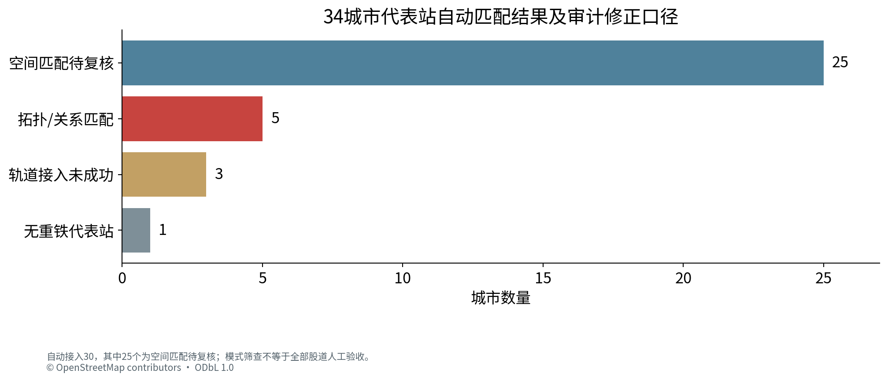
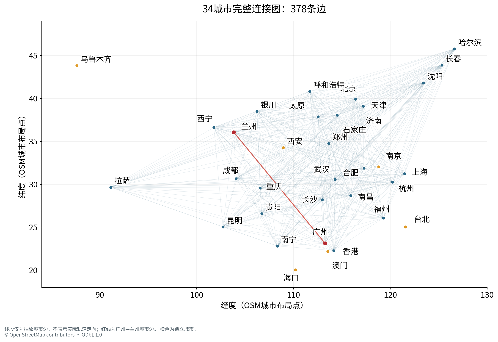
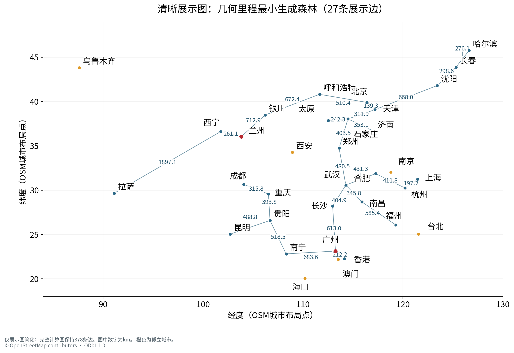
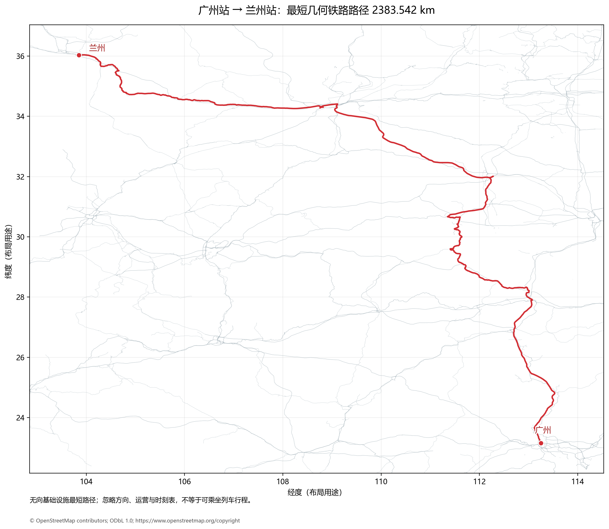
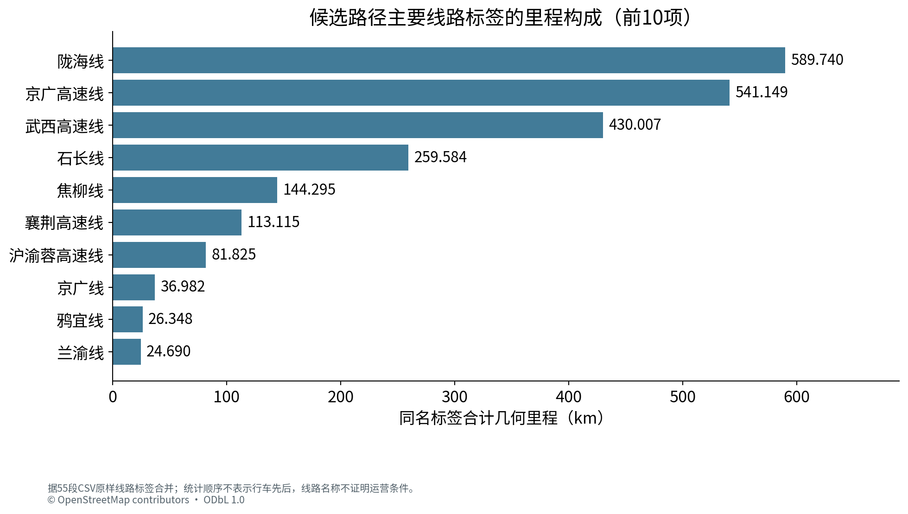
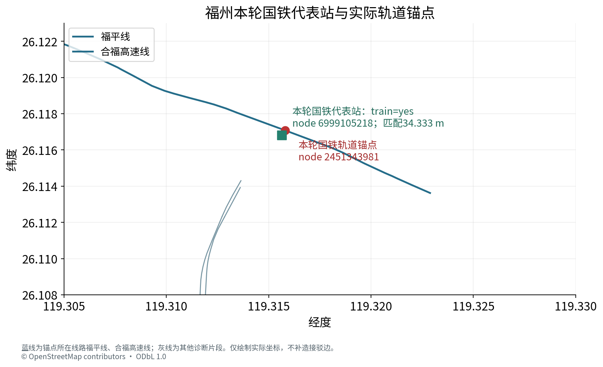
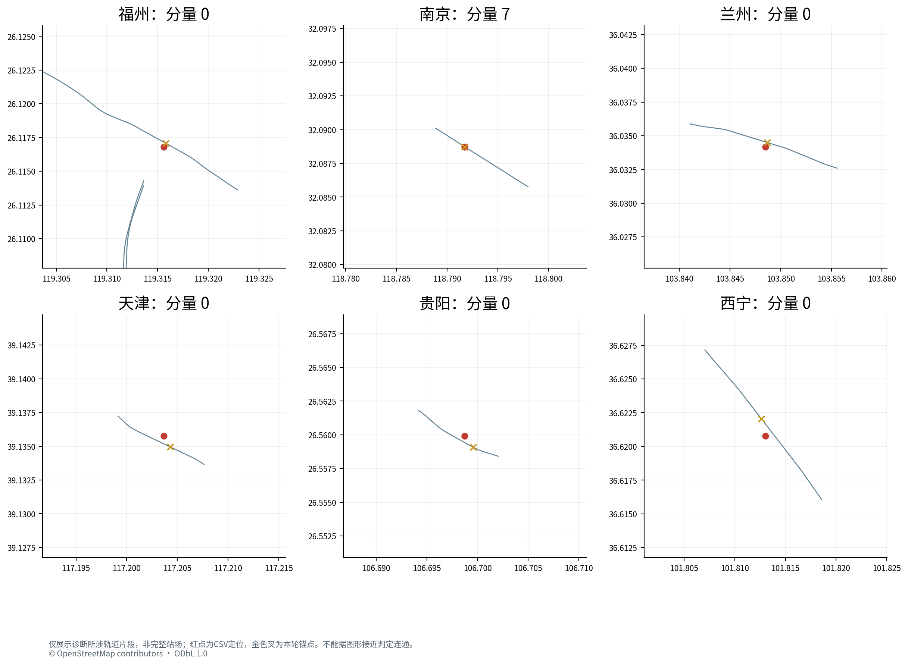

# 基于OpenStreetMap的省级行政区代表城市铁路网络构建及最短几何路径分析

《人工智能》课程大作业 · 第三轮真实数据与修正后质量核验

## 摘　要

本实验以34个省级行政区代表城市为节点，利用Geofabrik提供的中国与台湾OpenStreetMap真实PBF数据，构建按共享OSM节点连接的无向铁路基础设施图。沿轨道折线全部坐标点累计WGS84椭球测地距离，以代表车站的轨道锚点计算铁路长度；以Dijkstra算法单独求解广州站至兰州站的最短几何铁路路径。城市边取不经过第三个选定代表站节点的最短铁路通路。

本轮Windows真实运行采用图版本6、站点身份版本3。底层搜索图含294,604个节点、296,299条边和1,671个连通分量；城市图含34个节点、378条边和7个分量。30个代表站获得自动轨道锚点，其中5个按节点或站场关系匹配，25个为空间匹配待复核。福州已改为带train=yes的国铁站，匹配偏移34.333 m，并接入主体分量。

广州站至兰州站在当前筛选规则和锚点下的最短几何里程为2383.541508 km。独立对上传城市边表运行Dijkstra得到相同结果；55段的长度之和与总值差约9.1×10^(-13) km，相邻分段节点及首末锚点衔接通过。原始模式标签和局部折线提供了进一步核验依据，但不能据此宣称全国全部股道或旅客运营条件已验证。

关键词：OpenStreetMap；铁路拓扑；Dijkstra；几何里程；代表车站；数据质量

## 阅读说明

本报告第3版只使用本次Station_Diagnostics.zip中的同一轮结果，完成时间为北京时间2026年10月15日 11:35:58。原始输入保持字节不变，旧版351条边、8个分量的结果不混入本轮统计。全文区分用户程序自检、云端独立表级复算与局部原始OSM证据；本次未在云端重读全国PBF或完整路径GeoJSON。封面姓名、学号、班级和教师信息待填写。

## 1　作业题目与数据建模

### 1.1　任务与34城市口径

本阶段构建34个省级行政区代表城市的铁路交通网络，计算连接边的铁路距离，并仅求广州到兰州这一方向的最短几何铁路路径。“34个省会城市及直辖市”在此采用省会、自治区首府、直辖市及特别行政区代表城市的统一口径。没有可靠铁路连接的城市仍保留为孤立节点。

城市顺序：北京、天津、上海、重庆、石家庄、太原、呼和浩特、沈阳、长春、哈尔滨、南京、杭州、合肥、福州、南昌、济南、郑州、武汉、长沙、广州、南宁、海口、成都、贵阳、昆明、拉萨、西安、兰州、西宁、银川、乌鲁木齐、台北、香港、澳门。不生成34×34距离矩阵，不开展Dijkstra与A*对比，不以假设线路、直线距离或未运行实验替代真实数据。

### 1.2　来源、日期与覆盖

用户将已下载的中国与台湾PBF放入Windows项目data/raw，由程序离线读取。两文件复制时间戳均为2026-10-13T20:21:31Z，即北京时间2026年10月14日04:21:31。复制时间、文件登记时间和本轮计算完成时间含义不同；程序复用了相同输入指纹下的有效提取缓存，重建了模式修正后的全国图。

| 文件 | 字节数 | 复制时间（UTC） | 读取记录 |
| --- | --- | --- | --- |
| china-latest.osm.pbf | 1,608,188,315 | 2026-10-13T20:21:31Z | 头部有效；提取完成 |
| taiwan-latest.osm.pbf | 327,561,702 | 2026-10-13T20:21:31Z | 头部有效；提取完成 |

下载来源为https://download.geofabrik.de/asia/china-latest.osm.pbf及https://download.geofabrik.de/asia/taiwan-latest.osm.pbf。用户运行记录含文件大小、SHA-256和完整解析状态；上游校验状态为not_checked_offline，本次未联网核对发布者MD5，也未在云端重新计算PBF哈希。© OpenStreetMap contributors，数据许可为ODbL 1.0。

| 文件 | 实际扫描节点包围框：西、南、东、北 | 原始node记录 |
| --- | --- | --- |
| china-latest.osm.pbf | 71.61502, 7.19759, 135.67760, 54.01157 | 243,125,587 |
| taiwan-latest.osm.pbf | 108.60000, 10.36983, 126.46208, 37.40000 | 25,235,263 |

两个文件累计扫描268,360,850条原始node记录，需要的铁路或站点坐标引用为2,335,173个；这与底层搜索节点数、34个城市节点数是三个不同层次。包围框包含边界外引用节点，不能据其重叠推断区域完整覆盖。相关铁路子集按OSM类型与ID去重、保留最高版本，本轮无相关重复及冲突记录；不能将该记录扩大为所有原始地图对象的全量重复审计。香港站已接入主体；台北位于独立铁路分量；澳门未选重铁代表站。

### 1.3　轨道筛选、拓扑与几何长度

主要提取正常使用的railway=rail，检查usage、service、access及生命周期标签，排除明确地铁、轻轨、有轨电车、在建、废弃、拆除、工业军用、纯货运及受限线路。代表站和stop_area停靠成员另检查交通方式标签，避免关系本身未标subway、成员却为subway=yes的漏检。用途未知时如实标注，不据线路名称推断已确认客运。

service=yard/siding/spur/crossover等站场轨道不作为任意主干捷径，仅保留代表站接入主线需要的最短辅助支路。轨道按实际共享OSM节点连接；仅在图上交叉、距离相近或同名，不自动连通。双线及平行线保留各自拓扑，路径选择一条实际可行边，不把双线长度相加。渡轮和其他非轨道连接不加入。

若折线P=(p_0,p_1,…,p_m)，则L(P)=Σ d_WGS84(p_i,p_(i+1))/1000，单位km。程序使用pyproj.Geod(ellps="WGS84")对全部相邻坐标点求椭球测地距离并求和，不能用两端直线代替铁路长度，也不能对经纬度直接求平面length。主分析使用无向基础设施图，忽略行车方向、时刻表和车辆运营限制。

### 1.4　代表车站与城市边定义

每城选定一个明确主要重铁站，例如广州站、兰州站、重庆北站、成都东站、台北车站、香港西九龙站。名称匹配优先中文，拒绝英文相同但中文冲突的对象；城市布局点仅用于位置核验及绘图，超过80 km的候选拒绝。显式train=yes的站点证据优先，不能为了进入大分量而改选身份较弱的同名对象。

接入方式依次检查实际在轨节点、站场停靠关系、150 m内最近的实际OSM轨道节点。空间匹配只选择锚点，不添加站房到轨道的铁路边，偏移不计入铁路里程；小于150 m也不等于股道正确性已验收。不能把广州站与广州南站等同城不同车站合并为零距离节点。

城市边表示两个代表站锚点之间存在不经过第三个选定代表站锚点的铁路通路，边权取此约束下最短几何长度。允许经过普通车站与非省会城市。它不表示已确认直达列车，也不限制铁路进入其他城市行政范围。只阻止通过单个代表锚点，常可由同站其他股道或绕行线避开，因此城市图可能很稠密。

## 2　Dijkstra算法与程序设计

### 2.1　原理及复杂度

设无向图G=(V,E,w)，几何权重为正。起点dist[s]=0，其余无穷大；利用最小优先队列取出当前距离最小的节点u，对每条邻边(u,v)松弛：若dist[u]+w(u,v)<dist[v]，更新距离及前驱。非负边保证已确定的最小距离不再被之后的绕行改善。二叉堆实现通常为O((|V|+|E|)log|V|)，图与前驱存储为O(|V|+|E|)。

### 2.2　分层搜索与路径恢复

```text
dist[s] = 0; dist[other] = infinity
Q = priority_queue((0, s))
while Q is not empty:
    (d, u) = extract_min(Q)
    if d != dist[u]: continue
    if city_compression and u is another selected anchor:
        record_edge_and_path(s, u); continue
    for (v, weight) in neighbors(u):
        if d + weight < dist[v]:
            dist[v] = d + weight
            predecessor[v] = u
            push(Q, (dist[v], v))
restore the actual track path using predecessor
```

底层图保留实际OSM轨道及几何，压缩普通形状点。城市压缩使用heapq，在第三代表锚点停止扩展；广州至兰州底层查询使用SciPy稀疏图Dijkstra。相同端点的平行边取最短真实边用于搜索，同时保留对应OSM轨道以恢复路径。报告核验器独立对城市CSV运行Dijkstra；不把它表述为另一种算法的性能对比。

### 2.3　源码与复现

| 模块 | 作用 |
| --- | --- |
| extract.py | 两遍流式提取、SQLite缓存及类型/ID去重 |
| stations.py | 布局点、站点身份/模式筛查、轨道锚点 |
| graph.py | WGS84轨道长度、拓扑和受约束城市压缩 |
| export.py | CSV/GeoJSON、连续性及长度自检 |
| plotting.py | 完整图、展示图、站场和实际路线图 |
| tools/station_diagnostics.py | 只读缓存对象与成员证据，不重新映射或联网 |
| report/verify_results.py | 城市图、分段、偏移及诊断片段独立核验 |

项目要求Python 3.12 64位，依赖安装在项目.venv；install.bat安装，run.bat自动使用虚拟环境。路径可含中文与空格，窗口结束保留，运行日志在logs。已有有效PBF、依赖和字体后，主程序离线运行；大文件、提取SQLite与图缓存分开保存，版本及输入SHA-256控制缓存复用。图6/身份3对应已发布修正提交8c97b8f3dc5490baadd86613dd3e17152b868abc；运行状态未保存源码提交哈希，不能将对应版本等同于已独立核对用户全部源码字节。

模式修正版在云端通过31项测试，含真实福州局部证据回归及小型PBF全流程；全国真实结果来自本次用户Windows运行。云端没有执行Windows CMD，也没有重新扫描全国PBF。复核材料保持这两类证据的范围。

## 3　实验结果与讨论

### 3.1　网络规模与匹配状态

| 指标 | 本轮实际结果 |
| --- | --- |
| 城市节点 | 34，名称与规定顺序核验一致 |
| 底层搜索图 | 294,604节点；296,299边；1,671分量 |
| 城市图 | 378条唯一正权边；7分量 |
| 自动接入 | 30/34（88.24%），不是匹配正确率 |
| 拓扑或关系匹配 | 5个 |
| 空间匹配待复核 | 25个，含福州与兰州 |
| 识别到站但无可靠锚点 | 海口、西安、乌鲁木齐 |
| 无重铁代表站 | 澳门 |
| 拒绝候选对象 | 72个；不是72个城市或车站 |
| 缺坐标way/零长度段 | 程序记录0个缺几何way；2个零长度段被排除 |



代表站锚点数仍为30，但福州已从错误模式对象改为国铁站。海口、西安、乌鲁木齐保留真实站名、OSM ID与坐标，轨道锚点为空；没有用地铁站或远距离吸附替代。全部30个有锚点记录的站房—轨道偏移已按上传坐标独立用WGS84复算，均与CSV三位小数一致；选中站点及轨道节点的原始标签未见明确排除模式。模式标签检查通过不等于所有轨道用途和接入股道全部通过人工验证。

### 3.2　城市图连通性与稠密性

城市边表独立重建得到28城主体及6个孤立城市，合计7个分量。孤立城市为南京、海口、西安、乌鲁木齐、台北、澳门。主体每城度27，378=28×27/2，构成K28；全图边密度为67.38%。这是本轮数据导出图的性质，不代表现实铁路运营存在378对直达列车。

完整图保留378条边及对应路径索引。清晰展示版用Kruskal按几何边权选最小生成森林，共27条展示边，孤立节点照常保留；删减只用于画图，最短路与核验均使用完整图。边距离以km标注，完整精度保存在city_edges.csv，展示表mst_display_edges.csv逐一列出展示边。





### 3.3　广州至兰州的具体端点与最短结果

| 项目 | 广州起点 | 兰州终点 |
| --- | --- | --- |
| 选定代表站 | 广州站 | 兰州站 |
| OSM实际名称 | 广州火车站 | 兰州 |
| 站点对象 | relation 8075927 | node 269826006 |
| 轨道锚点 | 8308715569 | 11698233866 |
| 轨道经纬度 | 113.2523777, 23.1529413 | 103.8486599, 36.0345007 |
| 接入证据 | stop_area；停靠点train=yes | 站点train=yes；锚点所在way为陇海线 |
| 定位偏移 | 0.000 m，关系停靠定位 | 38.412 m，空间匹配待复核 |
| 底层分量 | 0 | 0 |

当前图上总长度为2383.541507726979 km，展示为2383.542 km。独立对完整city_edges.csv运行Dijkstra得到2383.541507726979 km，与用户底层图结果一致。两锚点WGS84测地线下界1691.584719 km，绕行系数约1.409；下界只用于排查异常短结果，不是铁路长度替代品。

经过的所选代表站对应城市序列只有“广州→兰州”，不表示沿途未经过其他城市或普通站，而是没有经过其选定的单个代表锚点。能从轨道节点原始名称识别的站点为广州、棠溪、耒阳西、衡山西、白马垅、大托铺、新开铺、捞刀河；这不是完整停站表，也不凭无名形状点补造站名。




路线PNG包含实际折线走向，区别于抽象城市连线。本次收到的是图像和分段CSV，未收到完整guangzhou_lanzhou_path.geojson；因此本报告不从PNG反推坐标，也不声称已独立逐形状点复算整条路线。路径包含高速线、普速线及动车走行联络段，忽略方向、车辆兼容、时刻表及运营准入，不能据此确认存在可乘坐的同一路径列车。

### 3.4　55段距离及可识别线路

分段按可识别停靠节点或线路标签变化，未命名段按OSM way变化；每个形状点不作为车站。55段完整精度求和为2383.541507726978 km，与总值差−9.094947017729282×10^(-13) km，为浮点累计舍入量级。累计列、相邻段终起轨道ID及首末锚点全部复算一致。展示表各段独立保留三位小数，其显示值累计可能因舍入与显示总值有差异，验证始终使用CSV完整精度。

路径含37种原样线路标签，包括未标注线路名。较长标签合计为陇海线589.740 km、京广高速线541.149 km、武西高速线430.007 km、石长线259.584 km、焦柳线144.295 km。未标注线路名合计0.741880 km，约占0.0311%。同名标签合并只描述构成，不改变55段原始顺序；“京广线”和“京广铁路”保持两个原始标签。




### 3.5　福州映射的真实修正证据

本轮选中福州国铁站node 6999105218，坐标119.3156324°E、26.1168094°N，原始标签railway=station、train=yes，名称与别名均明确为福州。锚点node 2451343981位于119.3157977°E、26.117081°N，WGS84偏移34.333 m；该节点真实出现在way 699510241“福平线”与way 775888938“合福高速线”的refs中，两线均为railway=rail、usage=main。局部完整refs和坐标已检查并复算折线长度。



拒绝表同时记录台湾浮洲node 1320065245/relation 10658521因中文名称冲突被拒绝，本地地铁站node 9157637252/9521844139因显式模式排除，stop_area 13303651/19659201因停靠成员均属排除模式而拒绝。前两轮已确认的同名和地铁停靠点误选在本轮所选福州记录中均未重现。国铁锚点现属底层分量0，福州城市度由0变27；城市边数由351增为378，分量由8减为7。该变化来自真实重建结果，未添加虚构连接或放宽150 m门槛。

34.333 m仍是空间匹配，不宣称已确认最佳乘降股道。诊断包还含滨海快线等其他候选关联片段；它们未被用作国铁代表站，也未与国铁站创建零距离连接。派生审计表保留原始锚点与“待复核”状态，不再沿用旧报告对本轮福州的拒绝结论。

### 3.6　孤立城市与剩余数据问题

| 城市 | 本轮真实证据 | 可支持的说明 |
| --- | --- | --- |
| 南京 | 站node 267225237；锚点同ID，在way 384136513“1道”，service=siding；底层分量7 | 站内辅助轨道已保留，仍未与主体相通。诊断只含部分相关way，不能确定完整断连原因。 |
| 海口 | 站node 12747885398，train=yes；无可靠锚点 | 未强行吸附或添加铁路渡轮；本轮不足以确定具体缺失环节。 |
| 西安 | 站node 9620122767，train=yes；无可靠锚点 | 保留国铁站身份，不用同名地铁对象替代；站场关系和轨道待核。 |
| 乌鲁木齐 | 站node 2987146433；无可靠锚点 | 已识别车站，不能以同名地铁或远处轨道补足。 |
| 台北 | 站node 3933501987；轨道锚点253385915；底层分量4 | 岛内铁路与本次其他选定代表站不相通，不构造跨海轨道。 |
| 澳门 | 未选符合本项目口径的重铁代表站 | 城市节点保留，不把轻轨当作railway=rail重铁连接。 |

剩余25个空间匹配应结合完整站场核验。优先检查西宁146.223 m（siding）、贵阳123.745 m（yard）、天津103.227 m（siding）以及路线终点兰州38.412 m（陇海线）。必要辅助支路已按真实共享节点保留，仍不能由偏移小于阈值推导出代表股道已确认。



筛选记录中7,120条way的usage未知，另有usage=spillway（2条）、usage=yard（1条）等异常值，不能据此宣称全图用途已清洗。不同分量的近邻端点只作疑似断点诊断，最多记录最近500项，本轮达到上限；500不是全国断点总数，也不构成自动补线授权。交叉分离、标签遗漏、站场拓扑与输入提取边界都可能影响连通性，需要完整局部数据进一步判断。

### 3.7　验证层次与结论边界

| 层次 | 本报告的证据范围 |
| --- | --- |
| 云端独立核验 | 34城市顺序、378条唯一正权边、7个分量、6个孤立点、K28性质、城市图Dijkstra、55段求和/累计/节点衔接、30个站点偏移 |
| 局部原始对象核验 | 同一提取指纹的站点与关系成员标签；诊断焦点锚点所在way真实refs、完整坐标及WGS84折线重算；福州新锚点两线归属 |
| 引用用户程序自检 | 全国PBF完整解析；所有城市边的轨道路径连续及逐点重算；最大城市边误差0；底层最短距离与压缩图一致 |
| 尚未独立完成 | 云端重读全国PBF、完整城市边及路线GeoJSON逐点复算、全部空间股道人工验收、真实列车运营可行性 |

连通性是筛选后的OSM图及当前代表锚点的性质。南京等孤立不等于现实没有国铁；广州至兰州可达也不等于对应客车可按此走行。所有距离统一标为“基于OSM铁路线形计算的几何里程”，不能称官方客运里程、计价里程或已验证可乘坐的行程。

## 4　结果讨论与代码交付

本轮真实重建已消除先前确认的福州选站模式错误，主体由27城扩大到28城，广州至兰州最短几何结果保持2383.542 km。城市图和分段表的独立复算支持数值自洽；局部原始证据支持福州与兰州的国铁身份和所在轨道。结果仍受25个空间接入待复核、代表站单锚点压缩定义、未知用途与数据缺漏影响，报告据实保留这些限制。

提交材料包含Word、PDF、正文Markdown、PNG/SVG图、用户本轮小型原始结果、独立审计和可运行源码。它是报告/源码/复核材料包，不替代Windows本机完整全国输出：edge_paths.geojson、railway_tracks.geojson和guangzhou_lanzhou_path.geojson等完整几何仍在本机outputs，未在本包虚构或以简化折线冒充。原始PBF、虚拟环境、全国缓存及日志不入包。

复现本轮表级核验无需扫描PBF：执行.venv\Scripts\python.exe report\verify_results.py report\v3\input。重建报告先安装report\requirements.txt，再用report\build_report.py --input report\v3\input --output-root report\v3，最后report\package_submission.py --report-root report\v3。该报告配置按已审阅输入哈希锁定，新数据必须重新审阅；首次下载报告字体需要网络，已有Word/PDF无需Python即可阅读。

## 参考文献与来源

[1] 用户提供的《人工智能》课程大作业要求及本次OSM第一阶段任务说明。

[2] 用户本轮Station_Diagnostics.zip：8份核心结果、候选拒绝表、只读缓存诊断、两幅本地PNG及范围说明；原始文件哈希见SOURCE_MANIFEST.json。

[3] Geofabrik. China / Taiwan OSM extracts. https://download.geofabrik.de/asia.html （具体来源、复制日期见正文）。

[4] OpenStreetMap contributors. https://www.openstreetmap.org/copyright ; ODbL 1.0: https://opendatacommons.org/licenses/odbl/1-0/ 。

[5] Dijkstra E. W. A Note on Two Problems in Connexion with Graphs. Numerische Mathematik, 1959, 1:269–271. DOI:10.1007/BF01386390.

[6] SciPy. scipy.sparse.csgraph.dijkstra. https://docs.scipy.org/doc/scipy/reference/generated/scipy.sparse.csgraph.dijkstra.html 。

[7] pyproj. Geod. https://pyproj4.github.io/pyproj/stable/api/geod.html 。

[8] Pyosmium. https://docs.osmcode.org/pyosmium/latest/ 。

## 附录A　34城市代表站与匹配状态

保持题目规定顺序。底层分量编号与7个城市分量的编号不是同一概念。海口、西安、乌鲁木齐有真实车站身份但锚点为空；澳门没有本口径代表站。空间待核不等于确认错误，也不等于全部通过。

| 序 | 城市 | 识别站名 | OSM对象 | 轨道锚点 | 偏移m | 分量 | 状态 |
| --- | --- | --- | --- | --- | --- | --- | --- |
| 1 | 北京 | 北京 | n/269996666 | 10218758523 | 8.51 | 0 | 空间待核 |
| 2 | 天津 | 天津 | n/273088049 | 10704467599 | 103.227 | 0 | 空间待核 |
| 3 | 上海 | 上海 | n/7161749775 | 9646171433 | 59.04 | 0 | 空间待核 |
| 4 | 重庆 | 重庆北 | r/21062191 | 13987036373 | 15.698 | 0 | 关系/节点 |
| 5 | 石家庄 | 石家庄 | n/7735515019 | 7735515020 | 11.964 | 0 | 空间待核 |
| 6 | 太原 | 太原 | n/273217367 | 7795687673 | 2.264 | 0 | 空间待核 |
| 7 | 呼和浩特 | 呼和浩特 | n/843121428 | 7777748190 | 50.719 | 0 | 空间待核 |
| 8 | 沈阳 | 沈阳 | n/6179162407 | 12633504284 | 28.308 | 0 | 空间待核 |
| 9 | 长春 | 长春 | n/9171411689 | 11607231861 | 53.318 | 0 | 空间待核 |
| 10 | 哈尔滨 | 哈尔滨 | n/334358067 | 10814219016 | 16.592 | 0 | 空间待核 |
| 11 | 南京 | 南京 | n/267225237 | 267225237 | 0.0 | 7 | 关系/节点 |
| 12 | 杭州 | 杭州 | n/7299090915 | 7595414249 | 3.012 | 0 | 空间待核 |
| 13 | 合肥 | 合肥 | n/6234423783 | 9922725803 | 33.022 | 0 | 空间待核 |
| 14 | 福州 | 福州 | n/6999105218 | 2451343981 | 34.333 | 0 | 空间待核 |
| 15 | 南昌 | 南昌 | n/1575144250 | 2280898000 | 95.319 | 0 | 空间待核 |
| 16 | 济南 | 济南 | n/269797019 | 13143731077 | 13.175 | 0 | 空间待核 |
| 17 | 郑州 | 郑州 | n/269806844 | 8312461934 | 16.796 | 0 | 空间待核 |
| 18 | 武汉 | 武汉 | n/579971406 | 9263976120 | 51.854 | 0 | 空间待核 |
| 19 | 长沙 | 长沙站 | w/973585033 | 1955561580 | 25.36 | 0 | 空间待核 |
| 20 | 广州 | 广州火车站 | r/8075927 | 8308715569 | 0.0 | 0 | 关系/节点 |
| 21 | 南宁 | 南宁站 | r/7911822 | 6422434191 | 0.0 | 0 | 关系/节点 |
| 22 | 海口 | 海口 | n/12747885398 | — | — | — | 未可靠接入 |
| 23 | 成都 | 成都东站 | r/9324932 | 6243808038 | 0.0 | 0 | 关系/节点 |
| 24 | 贵阳 | 贵阳 | n/1579354011 | 10125471391 | 123.745 | 0 | 空间待核 |
| 25 | 昆明 | 昆明 | n/9176075104 | 6682022863 | 34.134 | 0 | 空间待核 |
| 26 | 拉萨 | 拉萨 | n/7279526244 | 9646926468 | 79.679 | 0 | 空间待核 |
| 27 | 西安 | 西安 | n/9620122767 | — | — | — | 未可靠接入 |
| 28 | 兰州 | 兰州 | n/269826006 | 11698233866 | 38.412 | 0 | 空间待核 |
| 29 | 西宁 | 西宁 | n/307345596 | 13860434972 | 146.223 | 0 | 空间待核 |
| 30 | 银川 | 银川 | n/9118892109 | 10908347158 | 26.834 | 0 | 空间待核 |
| 31 | 乌鲁木齐 | 乌鲁木齐 | n/2987146433 | — | — | — | 未可靠接入 |
| 32 | 台北 | 台北 | n/3933501987 | 253385915 | 10.957 | 4 | 空间待核 |
| 33 | 香港 | 香港西九龍 | n/7919700008 | 3384138006 | 11.335 | 0 | 空间待核 |
| 34 | 澳门 | — | — | — | — | — | 无重铁代表站 |

## 附录B　广州至兰州55段几何里程

“—”表示该分界没有可靠站名，不将其编成车站。分段顺序及线路名称沿用真实CSV；完整起终轨道节点、OSM way和搜索边ID保留在原始表。以下km保留三位小数仅用于阅读，逐段相加验证使用完整精度。

| 段 | 线路标签 | 起点站名 | 终点站名 | 本段km | 累计km |
| --- | --- | --- | --- | --- | --- |
| 1 | 未标注线路名 | 广州 | — | 0.233 | 0.233 |
| 2 | 未标注线路名 | — | — | 0.253 | 0.486 |
| 3 | 未标注线路名 | — | — | 0.033 | 0.519 |
| 4 | 下行客车联络线 | — | — | 0.902 | 1.421 |
| 5 | 京广线 | — | 棠溪 | 1.062 | 2.483 |
| 6 | 京广线 | 棠溪 | — | 2.019 | 4.502 |
| 7 | 花广联络线 | — | — | 21.490 | 25.992 |
| 8 | 京广高速线 | — | 耒阳西 | 369.985 | 395.976 |
| 9 | 京广高速线 | 耒阳西 | 衡山西 | 95.746 | 491.723 |
| 10 | 京广高速线 | 衡山西 | — | 75.418 | 567.141 |
| 11 | 株洲南客专上行联络线 | — | — | 4.043 | 571.184 |
| 12 | 沪昆线 | — | — | 1.398 | 572.581 |
| 13 | 株洲西北联络线 | — | — | 2.709 | 575.290 |
| 14 | 京广线 | — | 白马垅 | 0.537 | 575.827 |
| 15 | 京广线 | 白马垅 | 大托铺 | 18.569 | 594.396 |
| 16 | 京广线 | 大托铺 | 新开铺 | 10.552 | 604.948 |
| 17 | 京广线 | 新开铺 | — | 4.243 | 609.192 |
| 18 | 长沙客车外绕线 | — | — | 4.999 | 614.190 |
| 19 | 京广铁路 | — | 捞刀河 | 12.604 | 626.795 |
| 20 | 京广铁路 | 捞刀河 | — | 0.285 | 627.079 |
| 21 | 石长线 | — | — | 259.584 | 886.663 |
| 22 | 石门北东南联络线 | — | — | 1.168 | 887.831 |
| 23 | 焦柳线 | — | — | 144.273 | 1032.104 |
| 24 | 未标注线路名 | — | — | 0.074 | 1032.178 |
| 25 | 焦柳线 | — | — | 0.022 | 1032.200 |
| 26 | 鸦南联络线 | — | — | 1.660 | 1033.860 |
| 27 | 鸦宜线 | — | — | 26.348 | 1060.208 |
| 28 | 金巴岭联络线 | — | — | 2.220 | 1062.428 |
| 29 | 沪渝蓉高速线 | — | — | 81.825 | 1144.253 |
| 30 | 襄宜联络线 | — | — | 1.593 | 1145.846 |
| 31 | 荆荆高速线 | — | — | 0.446 | 1146.292 |
| 32 | 襄荆高速线 | — | — | 113.115 | 1259.407 |
| 33 | 襄荆联络线 | — | — | 0.940 | 1260.347 |
| 34 | 东津联络线 | — | — | 3.473 | 1263.819 |
| 35 | 武西高速线 | — | — | 430.007 | 1693.827 |
| 36 | 西安东联络2线 | — | — | 0.394 | 1694.221 |
| 37 | 西安东动车走行2线 | — | — | 0.163 | 1694.383 |
| 38 | 西渝高速线 | — | — | 1.140 | 1695.524 |
| 39 | 包西高速线 | — | — | 18.960 | 1714.483 |
| 40 | 郭北联络线 | — | — | 16.279 | 1730.762 |
| 41 | 草店村疏解线 | — | — | 2.155 | 1732.918 |
| 42 | 徐兰大西疏解线 | — | — | 0.604 | 1733.521 |
| 43 | 大西高速线 | — | — | 4.895 | 1738.416 |
| 44 | 西成客专线 | — | — | 19.340 | 1757.757 |
| 45 | 陇海西成联络线 | — | — | 7.040 | 1764.796 |
| 46 | 三桥西安北动走线 | — | — | 0.042 | 1764.838 |
| 47 | 陇海西成联络线 | — | — | 0.143 | 1764.982 |
| 48 | 陇海线 | — | — | 71.333 | 1836.314 |
| 49 | 未标注线路名 | — | — | 0.084 | 1836.398 |
| 50 | 陇海线 | — | — | 280.098 | 2116.497 |
| 51 | 未标注线路名 | — | — | 0.064 | 2116.561 |
| 52 | 陇海线 | — | — | 233.305 | 2349.866 |
| 53 | 夏官营客车联络线 | — | — | 3.981 | 2353.847 |
| 54 | 兰渝线 | — | — | 24.690 | 2378.537 |
| 55 | 陇海线 | — | — | 5.004 | 2383.542 |

## 附录C　来源指纹、原图和交付范围

原始PBF的以下SHA-256取自用户运行记录，并非云端重算。13份上传文件含两幅PNG，均已在本次独立记录完整哈希；输入快照不混用旧轮次。REVIEWED_SNAPSHOT.json锁定本报告审阅输入，SOURCE_MANIFEST.json记录每份来源文件大小与指纹。

| PBF文件 | 用户程序记录SHA-256 |
| --- | --- |
| china-latest.osm.pbf | f1c602a55455819262b8183f0c0cb64c<br>d95b7f78cabc3ac98f4e8762d8e80fa6 |
| taiwan-latest.osm.pbf | f0854a692a189189fe54fb5e6fb222ad<br>32db7f29bfe0fc26b05343a9d8f2a328 |

用户本地广州至兰州路线图和34站局部检查PNG已按原始字节纳入figures与input/figures。报告另由CSV生成完整城市图、展示最小生成森林和统计图，由诊断JSON生成实际局部轨道片段图，并提供SVG。局部片段没有代替未上传的全国底层铁路检查图或完整轨道GeoJSON；这些仍应保留在用户本机成果目录。

OSM数据及派生图件：© OpenStreetMap contributors / ODbL 1.0，见根目录DATA_LICENSE.md。PDF嵌入Noto Sans SC字体子集，完整字体不入包，SIL Open Font License 1.1文本见report/fonts/OFL.txt。源代码适用根目录LICENSE，源代码许可与地图数据许可分别适用。
